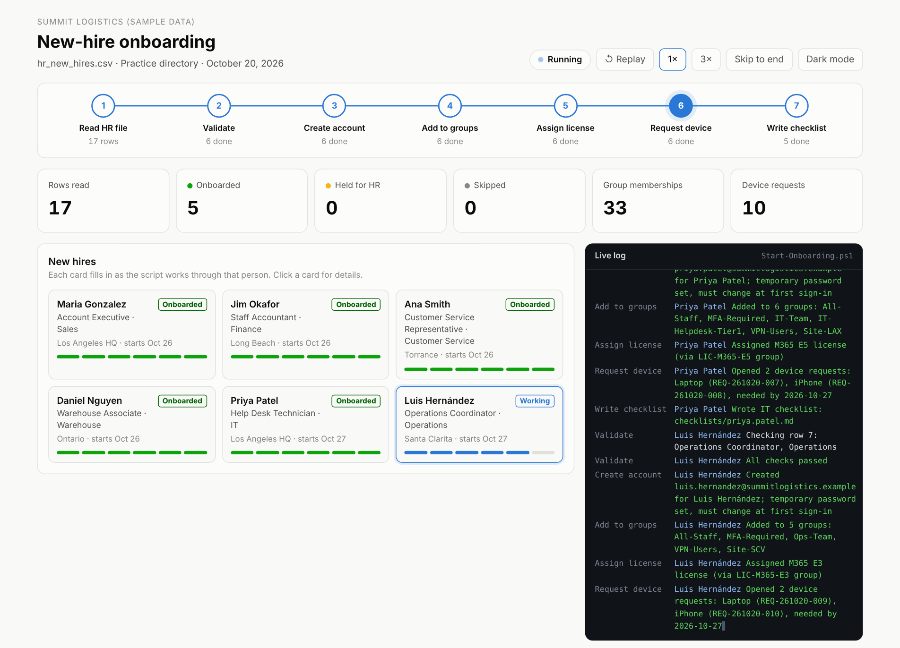
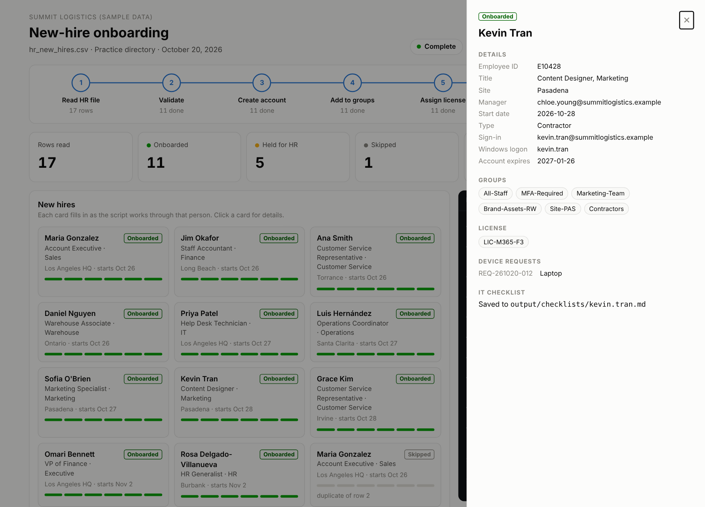

# New-Hire Onboarding Automation

A PowerShell script that reads new hires from an HR spreadsheet and sets each person up: account, unique username and email, department and site groups, license, device requests, and an IT checklist. Rows with problems go back to HR instead of being guessed at. A dashboard replays every run step by step.

**[Watch a run on the live dashboard](https://raulit-eng.github.io/new-hire-onboarding/)**



## Why I built this

At my last job, I owned IT onboarding for new hires from start to finish. Every new hire meant the same steps: create the account, add the right groups, assign a license, get hardware ready, and make sure nothing was missed on day one. The slow part was rarely the clicking. It was HR files with missing managers, departments nobody had set up, duplicate rows and rehires.

This script does the repeatable work and pushes the judgment calls back to the right people.

## What it does

For each row in the HR file, the script:

1. **Checks the row:** required fields, employee ID format, a known department and site, a manager who exists in the directory, a sensible start date
2. **Catches duplicates and rehires:** it skips a duplicate row or someone who already has an account, and holds a former employee with a disabled account for HR, so the old account gets reactivated instead of a second one being created
3. **Builds the username:** `first.last`, with accents and apostrophes removed (`Hernández` becomes `hernandez`), a number added if it's taken (`ana.smith2`), and the Windows logon name kept within Active Directory's 20-character limit
4. **Creates the account** with a random temporary password that must be changed at first sign-in. The password is never written to a log or file.
5. **Adds groups** from the department's access profile, plus company-wide and site groups
6. **Assigns a license** through a license group, the way Entra ID group-based licensing works
7. **Opens device requests** for the role's laptop, phone, tablet or headset
8. **Writes an IT checklist** for each person: what the script did, what IT still needs to do before day one, day one with the new hire, and the first week

Contractors automatically get a "Contractors" group, no VPN access, a lighter license, and an account that expires after 90 days.

### On the sample HR file

| Result | Count | Examples |
|---|---:|---|
| Onboarded | 11 | `ana.smith2` because `ana.smith` already exists; a contractor with an expiring account; a 23-character name with a shortened Windows logon |
| Held for HR | 5 | Unknown department (Legal), missing manager, manager not in the directory, start date already passed, possible rehire |
| Skipped | 1 | Duplicate row |

See [`output/hr_issues.csv`](output/hr_issues.csv) and the [sample checklists](output/checklists/).

## The dashboard

Each run builds a dashboard that replays what the script did, step by step:

- **Pipeline** of the 7 steps, from reading the HR file to writing checklists, showing which step is running and how many people have finished each one
- **A card for each new hire,** filling in as the script works on that person
- **A live log console** showing each message as the script logs it
- **"Sent back to HR"** and **"Skipped"** tables that fill in as rows are reached
- **Click any person** to see their groups, license, device requests and checklist



## How to run it

You need [PowerShell 7](https://learn.microsoft.com/powershell/scripting/install/installing-powershell) on Windows, macOS or Linux.

```powershell
# Run the sample file against a fresh practice directory
./Start-Onboarding.ps1 -AsOf 2026-10-20 -Reset
```

`-AsOf` sets "today" so the sample start dates still count as upcoming. Leave it off for real use. The dashboard is written to `docs/index.html`; open it in any browser.

Run it again and nobody is onboarded twice: everyone who already has an account is skipped.

### Practice directory vs. Active Directory

By default, the script works against a **practice directory** (`output/practice_directory.json`), so it's safe to try anywhere.

To use it with a real domain:

```powershell
# 1. Preview every change without making any
./Start-Onboarding.ps1 -HRFile '\\hr\exports\new_hires.csv' -Mode ActiveDirectory -WhatIf

# 2. Run it for real
./Start-Onboarding.ps1 -HRFile '\\hr\exports\new_hires.csv' -Mode ActiveDirectory
```

Active Directory mode needs the RSAT ActiveDirectory module and permission to create users in the OU set in `config/onboarding.json`. Its calls are covered by tests with mocked AD cmdlets, but it has not been run against a live domain, so **try it in a test lab first**.

## Configuration

Everything about who gets what lives in [`config/onboarding.json`](config/onboarding.json), not in the code:

- **Departments:** groups, license, devices and apps for each department
- **Sites:** a site code and site group for each office
- **Company-wide groups** everyone gets, such as All-Staff and MFA-Required
- **Contractor rules:** extra groups, removed groups, license, and how long the account lasts

Adding a department, like Legal from the sample file, is a config change, not a code change.

## Outputs

| File | What it's for |
|---|---|
| `output/onboarding_summary.csv` | One row per person: status, username, email, groups, license, requests |
| `output/hr_issues.csv` | Rows HR needs to fix, with the reason |
| `output/device_requests.csv` | Device requests to send to the ticketing system or hardware team |
| `output/checklists/<username>.md` | IT checklist for each new hire |
| `output/run_log.json` | Every step of the run, used by the dashboard |
| `docs/index.html` | The dashboard |

## Tests

27 [Pester](https://pester.dev) tests cover username rules, HR row checks, access plans, password strength, a full run on the sample file, rerun safety, preview mode, the guarantee that no password is ever written to a file, and Active Directory calls with the AD cmdlets mocked.

```powershell
Install-Module Pester -MinimumVersion 5.5 -Scope CurrentUser
Invoke-Pester ./tests
```

## Project structure

```
Start-Onboarding.ps1        # run this
Build-Dashboard.ps1         # builds docs/index.html from a run log (runs automatically)
src/Onboarding.psm1         # the building blocks: checks, usernames, plans, provisioning, checklists
config/onboarding.json      # departments, sites, groups, licenses, devices
data/hr_new_hires.csv       # sample HR export
data/directory_seed.json    # sample existing accounts
templates/                  # dashboard page template
tests/                      # Pester tests
```

## Skills shown

- PowerShell scripting: modules, `-WhatIf` and `ShouldProcess`, secure strings, Pester tests
- Active Directory user and group provisioning, group-based licensing
- Identity lifecycle: username standards, duplicates, rehires, contractor expiry
- Working with HR data: validation, and clear handoffs back to HR

## Author

**Raul Astorga** – IT Support & Systems Consultant
