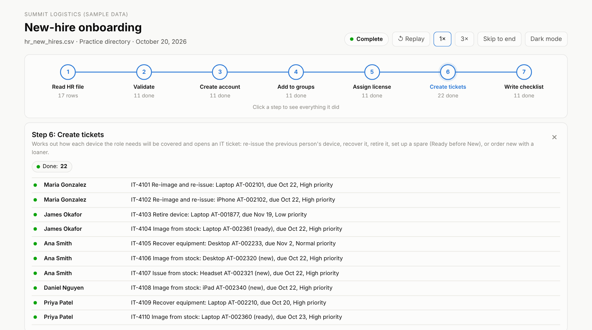
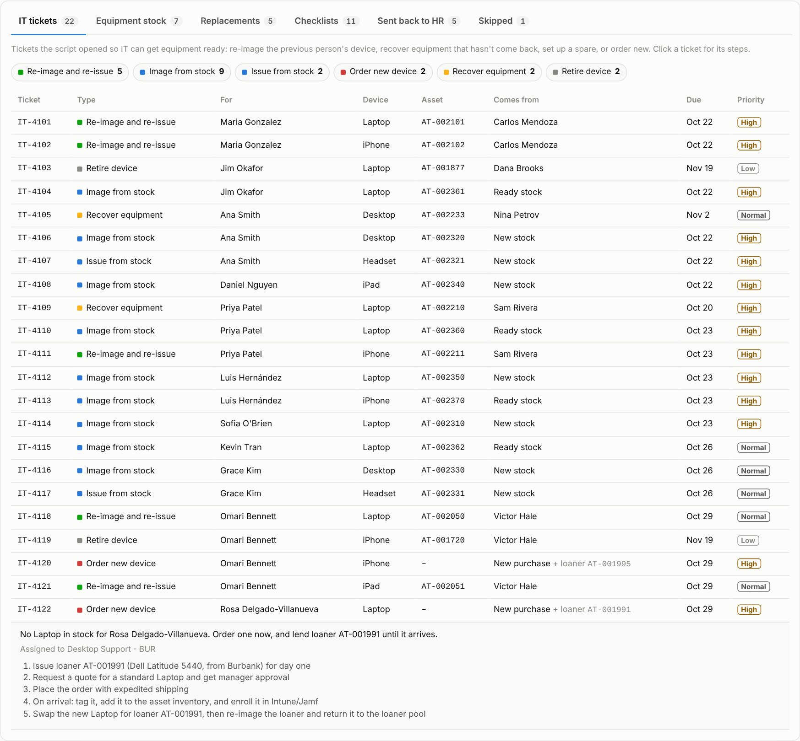
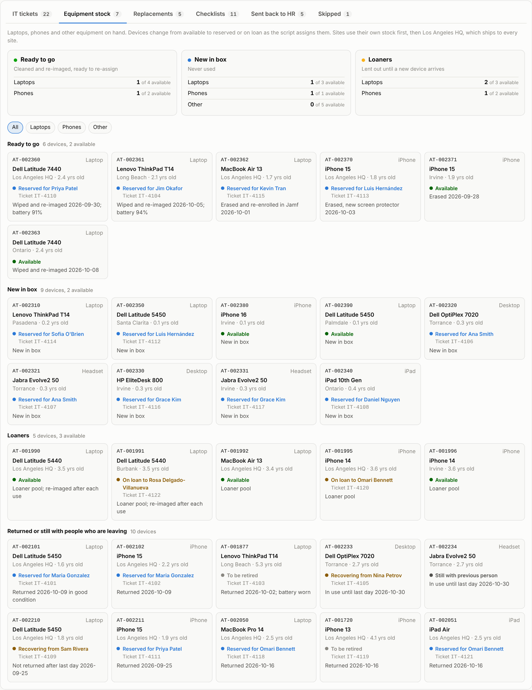
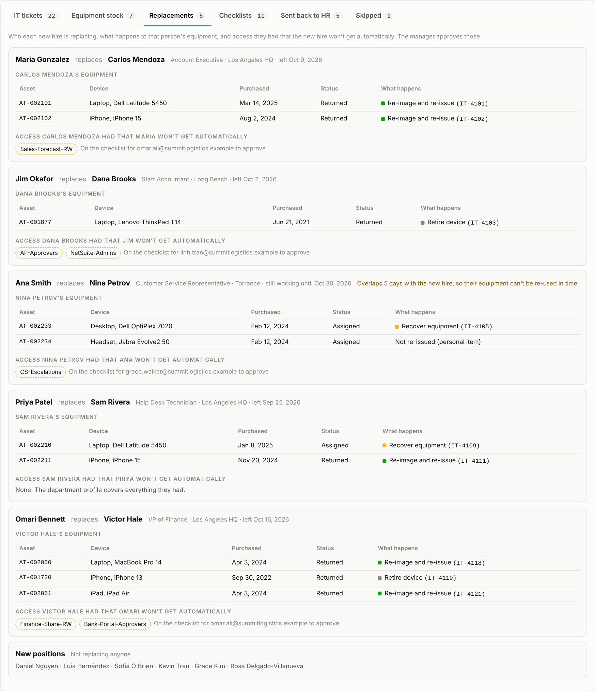
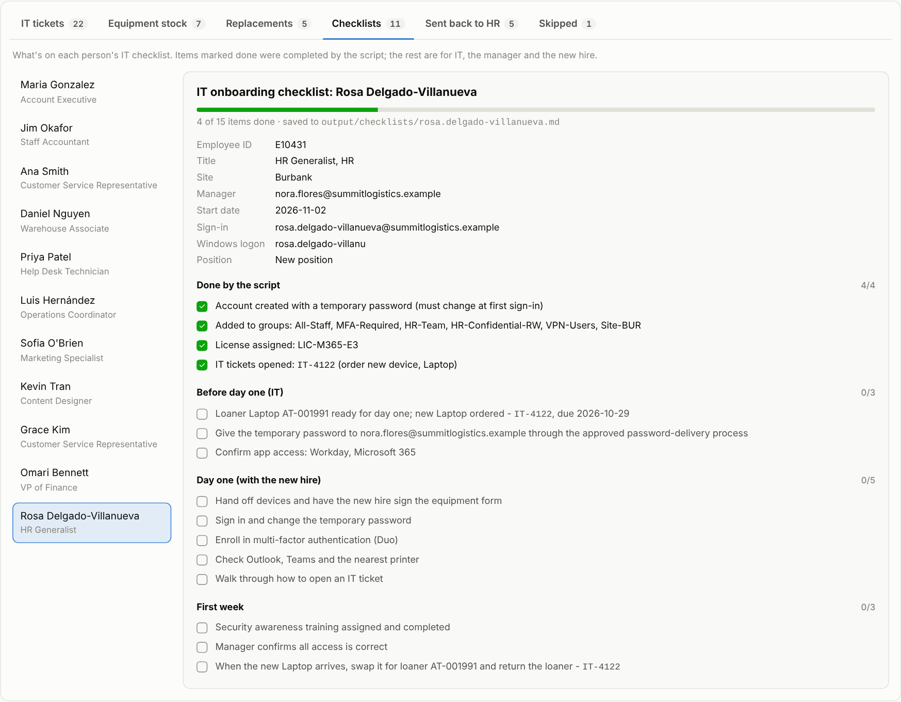

# New-Hire Onboarding Automation

A PowerShell script that reads new hires from an HR spreadsheet and sets each person up: account, unique username and email, department and site groups, license, IT tickets to get their equipment ready, and an IT checklist. When a new hire is replacing someone, it re-uses that person's equipment where it makes sense and flags access the manager needs to decide on. Rows with problems go back to HR instead of being guessed at. A dashboard replays every run step by step.

**[Watch a run on the live dashboard](https://raulit-eng.github.io/new-hire-onboarding/)**


## Why I built this

At my last job, I owned IT onboarding for new hires from start to finish. Every new hire meant the same steps: create the account, add the right groups, assign a license, get hardware ready, and make sure nothing was missed on day one. The slow part was rarely the clicking. It was HR files with missing managers, departments nobody had set up, duplicate rows and rehires.

This script does the repeatable work and pushes the judgment calls back to the right people.

## What it does

For each row in the HR file, the script:

1. **Checks the row:** required fields, employee ID format, a known department and site, a manager who exists in the directory, a sensible start date
2. **Catches duplicates and rehires:** it skips a duplicate row or someone who already has an account, and holds a former employee with a disabled account for HR, so the old account gets reactivated instead of a second one being created
3. **Builds the username:** `first.last`, with accents and apostrophes removed (`Hernández` becomes `hernandez`), a number added if it's taken (`ana.smith2`), and the Windows logon name kept within Active Directory's 20-character limit
4. **Creates the account** with a random temporary password that must be changed at first sign-in. The password is never written to a log or file.
5. **Adds groups** from the department's access profile, plus company-wide and site groups
6. **Assigns a license** through a license group, the way Entra ID group-based licensing works
7. **Opens IT tickets** for every device the role needs (see below)
8. **Checks who they're replacing,** if anyone, and lists access that person had that the new hire won't get automatically, so the manager can decide
9. **Writes an IT checklist** for each person: what the script did, what IT still needs to do before day one, equipment to recover, day one with the new hire, and the first week

### IT tickets for equipment

For each device the role needs, the script works out the best way to cover it and opens a ticket with steps, a due date (2 business days before the start date), a priority, and the site's Desktop Support team:

| Ticket | When | What IT does |
|---|---|---|
| **Re-image and re-issue** | The previous person returned the device and it's still within its lifecycle | Wipe it, reset it with Autopilot or Jamf, install role apps, re-assign it |
| **Recover equipment** | The previous person hasn't returned it, or still works there | Arrange the return after their last day; lock and wipe remotely if it doesn't come back |
| **Retire device** | The returned device is past its lifecycle (e.g. a 4-year-old laptop) | Wipe, remove from management, recycle |
| **Image from stock** | No re-usable device, but a spare is in stock | Set up the spare, ship it from HQ if needed |
| **Issue from stock** | Personal items like headsets, which are never re-issued | Hand out a new one |
| **Order new device** | Nothing available | Order one, and issue a loaner for day one; swap it out when the new device arrives |

### Equipment stock

Spare equipment is kept in three pools in [`data/equipment_inventory.csv`](data/equipment_inventory.csv):

| Pool | What it is | How it's used |
|---|---|---|
| **Ready** | Cleaned and re-imaged, ready to re-assign | Used first: it saves buying new |
| **New** | New in box | Used when no Ready device fits |
| **Loaner** | Shared devices for temporary use | Only lent out while a new device is on order; never assigned permanently |

Each site uses its own stock first, then the central depot at Los Angeles HQ, which ships to every site. Branch sites don't ship to each other. Devices are reserved as they're assigned, so two people never get the same one, and the next run knows they're taken. Device lifecycles, pool order, the depot and personal items are set in the config.

Contractors automatically get a "Contractors" group, no VPN access, a lighter license, and an account that expires after 90 days.

### On the sample HR file

| Result | Count | Examples |
|---|---:|---|
| Onboarded | 11 | `ana.smith2` because `ana.smith` already exists; a contractor with an expiring account; a 23-character name with a shortened Windows logon |
| IT tickets | 22 | 5 re-issued from the previous person, 11 from stock (4 Ready, 7 New), 2 new orders with loaners, 2 recoveries, 2 retirements |
| Replacements | 5 | Including one where the previous person is still working, so their desktop is recovered after their last day |
| Held for HR | 5 | Unknown department (Legal), missing manager, manager not in the directory, start date already passed, possible rehire |
| Skipped | 1 | Duplicate row |

See [`output/hr_issues.csv`](output/hr_issues.csv) and the [sample checklists](output/checklists/).

## The dashboard

Each run builds a dashboard that replays what the script did, step by step:

- **Pipeline** of the 7 steps, from reading the HR file to writing checklists, showing which step is running and how many people have finished each one. **Click any step** to see everything it did: what it checks, how many items finished or need attention, and every message it logged
- **A card for each new hire,** filling in as the script works on that person
- **A live log console** showing each message as the script logs it
- **Tabs** that fill in as rows are reached:
  - **IT tickets:** every ticket, filterable by type; click one to see its steps
  - **Equipment stock:** Ready, New and Loaner laptops and phones, with each device changing from available to reserved or on loan as the script assigns it
  - **Replacements:** who each hire replaces, what happens to that person's equipment, and access the manager needs to approve
  - **Checklists:** pick a person to see their whole checklist, with done and to-do items
  - **Sent back to HR** and **Skipped**
- **Click any person** for their groups, license, replacement, tickets and checklist












## How to run it

You need [PowerShell 7](https://learn.microsoft.com/powershell/scripting/install/installing-powershell) on Windows, macOS or Linux.

```powershell
# Run the sample file against a fresh practice directory
./Start-Onboarding.ps1 -AsOf 2026-10-20 -Reset
```

The HR file has one row per new hire. The `ReplacingEmployeeID` column is optional: leave it blank for a new position, or put the employee ID of the person being replaced.

`-AsOf` sets "today" so the sample start dates still count as upcoming. Leave it off for real use. The dashboard is written to `docs/index.html`; open it in any browser.

Run it again and nobody is onboarded twice: everyone who already has an account is skipped.

### Practice directory vs. Active Directory

By default, the script works against a **practice directory** (`output/practice_directory.json`), so it's safe to try anywhere.

To use it with a real domain:

```powershell
# 1. Preview every change without making any
./Start-Onboarding.ps1 -HRFile '\\hr\exports\new_hires.csv' -Mode ActiveDirectory -WhatIf

# 2. Run it for real
./Start-Onboarding.ps1 -HRFile '\\hr\exports\new_hires.csv' -Mode ActiveDirectory
```

Active Directory mode needs the RSAT ActiveDirectory module and permission to create users in the OU set in `config/onboarding.json`. Its calls are covered by tests with mocked AD cmdlets, but it has not been run against a live domain, so **try it in a test lab first**.

## Configuration

Everything about who gets what lives in [`config/onboarding.json`](config/onboarding.json), not in the code:

- **Departments:** groups, license, devices and apps for each department
- **Sites:** a site code and site group for each office
- **Company-wide groups** everyone gets, such as All-Staff and MFA-Required
- **Contractor rules:** extra groups, removed groups, license, and how long the account lasts
- **Equipment:** device lifecycles, which stock pool to use first, the central depot, personal items that are never re-issued, ticket numbering, and how many business days before the start date equipment should be ready

Adding a department, like Legal from the sample file, is a config change, not a code change.

## Outputs

| File | What it's for |
|---|---|
| `output/onboarding_summary.csv` | One row per person: status, username, email, groups, license, requests |
| `output/hr_issues.csv` | Rows HR needs to fix, with the reason |
| `output/tickets.csv`, `output/tickets.json` | IT tickets with steps, ready to import into a ticketing system |
| `output/checklists/<username>.md` | IT checklist for each new hire |
| `output/run_log.json` | Every step of the run, used by the dashboard |
| `docs/index.html` | The dashboard |

## Tests

43 [Pester](https://pester.dev) tests cover username rules, HR row checks, access plans, password strength, ticket decisions (re-issue, recover, retire, stock, order), stock pools, loaners and the depot rule, replacements and access gaps, a full run on the sample file, rerun safety, preview mode, the guarantee that no password is ever written to a file, and Active Directory calls with the AD cmdlets mocked.

```powershell
Install-Module Pester -MinimumVersion 5.5 -Scope CurrentUser
Invoke-Pester ./tests
```

## Project structure

```
Start-Onboarding.ps1        # run this
Build-Dashboard.ps1         # builds docs/index.html from a run log (runs automatically)
src/Onboarding.psm1         # the building blocks: checks, usernames, plans, provisioning, checklists
config/onboarding.json      # departments, sites, groups, licenses, devices
data/hr_new_hires.csv       # sample HR export
data/directory_seed.json    # sample existing accounts, including people who left
data/equipment_inventory.csv # sample equipment: Ready, New and Loaner stock, plus returned devices
templates/                  # dashboard page template
tests/                      # Pester tests
```

## Skills shown

- PowerShell scripting: modules, `-WhatIf` and `ShouldProcess`, secure strings, Pester tests
- Active Directory user and group provisioning, group-based licensing
- Identity lifecycle: username standards, duplicates, rehires, contractor expiry, access reviews when someone is replaced
- IT asset lifecycle: re-using, recovering and retiring equipment, and ticket workflows
- Working with HR data: validation, and clear handoffs back to HR

## Author

**Raul Astorga** – IT Support & Systems Consultant
